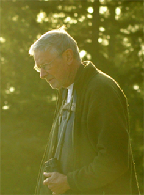

## Harvey’s footsteps

<figure class="mxcw-harvey-portrait"></figure>

This project is dedicated to the memory of Harvey Janszen (July 11, 1946–May 10, 2021) and other fellow naturalists, including Hans Roemer, who have passed away in recent years. Harvey spent decades getting to know the plants of the Salish Sea—collecting more than 3000 plant specimens, keeping field journals from 1973 to 2017, and compiling species checklists for the southern Gulf Islands, the Saanich Peninsula, and the San Juan Islands. Through this initiative we invite you to help carry this work forward, by sharing your local plant knowledge and contributing to the co-creation of a living *Flora of the W̱SÁNEĆ/Saanich Peninsula.*

<div class="mxcw-supporters">
<p class="mxcw-supporters-title">With thanks to our supporters</p>
<ul class="mxcw-supporters-list">
<li></li>
<li class="mxcw-supporter-tall"></li>
<li></li>
<li class="mxcw-supporter-tall"></li>
<li></li>
<li class="mxcw-supporter-tall"></li>
</ul>
</div>

```{r, echo=FALSE, message=FALSE, warning=FALSE}
source("scripts/Janszen_checklists_mapbox.R")
janszenChecklistsMap
```
